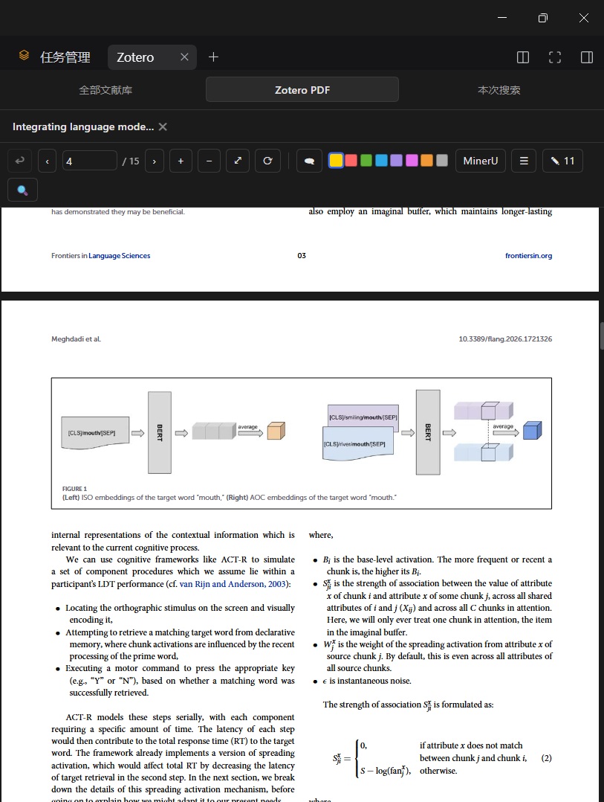
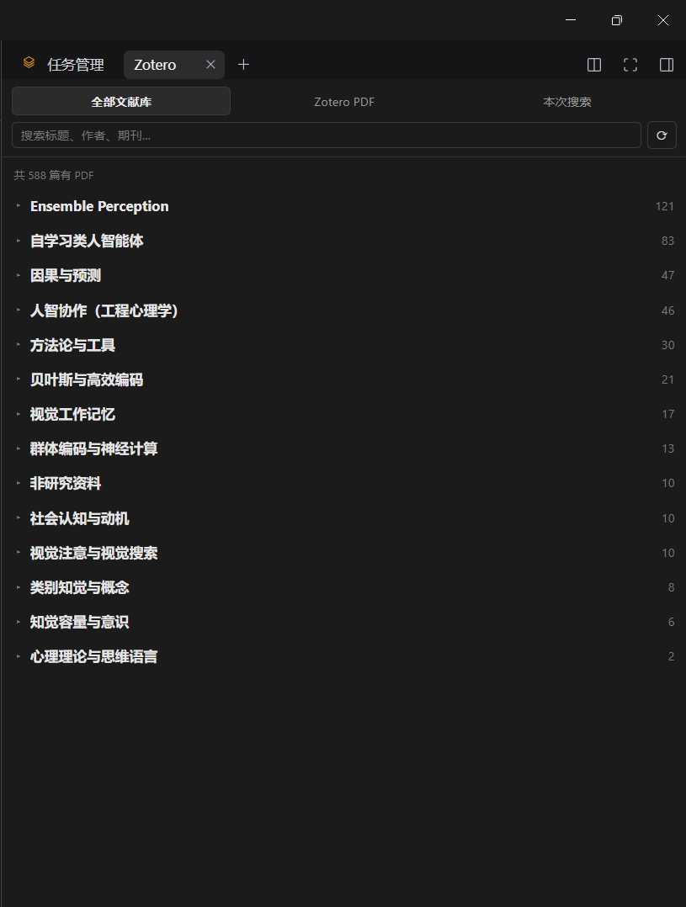
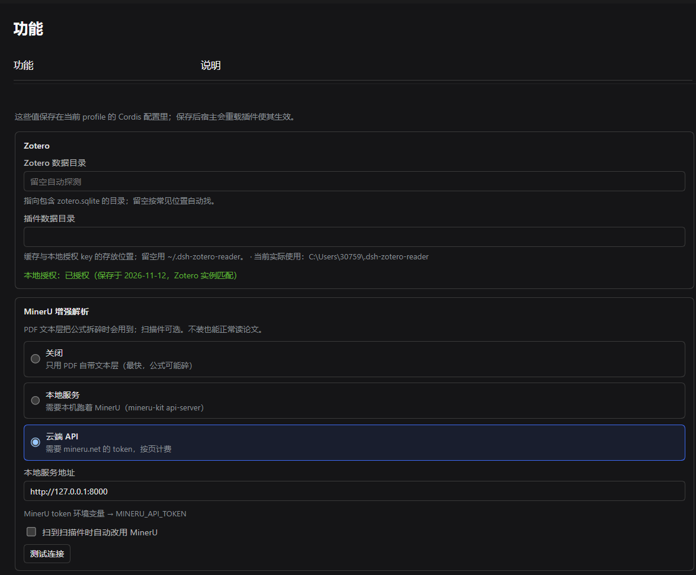
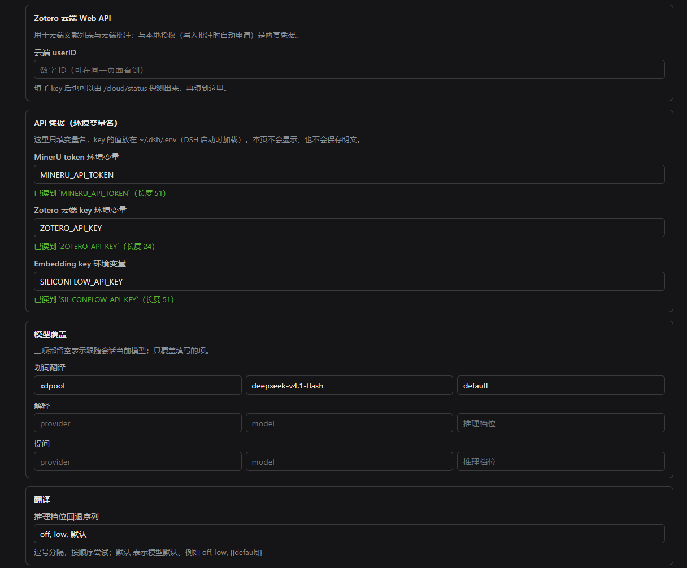

# dsh-zotero-reader — Zotero reader for DSH

[中文](README.md) | **English**

Read your Zotero PDFs in the DSH right sidebar: page-accurate Q&A, a real outline, and annotations that round-trip with Zotero.



## Why

Research in DSH means papers live in Zotero but reading happens elsewhere. Citing a passage means noting the page by hand; finding out what a paper argues means flipping through it; highlights made in Zotero are invisible everywhere else.

This plugin lets the assistant read PDFs straight out of your Zotero library, keeping content aligned to pages:

- Ask it to search your Zotero library; every result carries an `itemKey`, and `zotero://<key>` in an answer opens the paper
- The right sidebar renders the PDF, so answers cite "page N" exactly — click the page to jump there and highlight it
- The outline is extracted from the PDF text layer by font size, so the real section structure shows up
- Select text to translate, explain, or write it back to Zotero as a highlight

## Features

| Feature | Notes |
|---|---|
| Library tools | `search_zotero_library` / `read_zotero_paper` / `ask_zotero_paper` for the model |
| Sidebar reader | pdf.js rendering with zoom, page jump, continuous scroll |
| Library browsing | All papers grouped two levels deep by your Zotero collections, searchable; plus a "found in this conversation" view |
| Page-accurate Q&A | Passages come from the text layer, so page numbers are real; page references in answers are clickable |
| Outline | Headings detected by font size (more reliable than line length or word lists); click to jump |
| Selection actions | Translate / explain / ask / highlight |
| Annotations | Shows existing Zotero annotations; highlights write back to Zotero |
| Multiple PDFs | One sidebar tab per paper, each keeping its own page and zoom |
| MinerU (optional) | Re-parse scanned or formula-garbled PDFs; off by default |

## Screens



The library browses every paper along your Zotero collection tree.


"Found in this conversation" shows only the papers the assistant found in this conversation.

## Install

Install with DSH's own plugin command, replacing `desktop` with the profile you actually use:

```bash
dsh plugin --profile desktop add github:minhaoli/dsh-zotero-reader
```

This installs the plugin and its dependency (`pdfjs-dist`) into that profile's `node_modules`. The command forwards its arguments to pnpm, so it does not register the bundle for you — add the package name to the same profile's `package.json`:

```json
{
  "dsh": { "profile": { "bundles": ["...existing...", "dsh-zotero-reader"] } }
}
```

Restart DSH. A "Zotero reader" card appears on the right sidebar's start page.

To upgrade, run the same `dsh plugin ...` command again.

### Developing from a local directory

To change the code, link to the source directory instead — reloading the plugin picks up edits:

```json
{ "dependencies": { "dsh-zotero-reader": "link:D:/path/to/dsh-zotero-reader" } }
```

With a link install you must install dependencies yourself once: `npm i`.

## Configuration





The configuration appears directly on the DSH sidebar → Plugins → dsh-zotero-reader bundle page (between the description and the rows). Saving writes to the current profile's `cordis.patch.yml`, and the host reloads the plugin so the change takes effect.

API keys are stored as **environment variable names**; the values live in `~/.dsh/.env` (loaded when DSH starts). For example, put `MINERU_API_TOKEN=your-token` in `.env` and point `mineruTokenEnv` at it. Restart DSH after editing `.env`.

| Key | Default | Meaning |
|---|---|---|
| `zoteroDataDir` | auto-detected | Zotero data directory (contains `zotero.sqlite`) |
| `mineruMode` | `none` | `none` / `local` / `cloud` |
| `mineruLocalUrl` | `http://127.0.0.1:8000` | Local MinerU service URL |
| `mineruTokenEnv` | `MINERU_API_TOKEN` | **Environment variable name** holding the MinerU token |
| `mineruAutoOnScanned` | `true` | Switch to MinerU automatically for scanned PDFs |
| `cloudApiKeyEnv` | `ZOTERO_API_KEY` | Environment variable name holding the Zotero cloud key |
| `cloudUserID` | empty | Zotero cloud userID |
| `embeddingApiKeyEnv` | `SILICONFLOW_API_KEY` | Environment variable name holding the embedding key |

### Writing annotations

Writes go through the [Zotero local API](https://www.zotero.org/support/dev/web_api/v3/local_api), which requires:

1. **Zotero 10 or later** (the local API is read-only in 7/8)
2. Zotero running, with Settings → Advanced → "Allow other applications on this computer to communicate with Zotero" enabled
3. A one-time confirmation dialog on the first write — choose "Allow" or "Always Allow"

Reading existing annotations has none of these requirements: it uses a database snapshot and works while Zotero is running.

## Where data lives

- Settings and cache: `~/.dsh-zotero-reader/` (`settings.json`, `cache/`, `translate/`)
- The Zotero database is never modified directly; writes go through the local API so Zotero handles indexing and sync itself

## Development

```bash
node --check index.js          # syntax check
node test/host-e2e.mjs         # host-side end-to-end (needs a local Zotero library)
```

`test/host-e2e.mjs` exercises the real code path: it runs `apply()` against a minimal proxy context, captures the handler passed to `webServer.register`, and drives it with fake req/res objects.

## Known limitations

- Page numbers are exact on the native text-layer path; files re-parsed by MinerU get approximate pages, marked "≈" in the UI
- Multi-page selections only use the first page (Zotero stores annotations per page)
- Writing annotations needs Zotero 10+; otherwise the Highlight button is disabled with an explanation
- The outline falls back to section keywords for layouts where headings match body text in size

## Credits

This plugin's approach was informed by [@ggboy123/dsh-paper-reader](https://github.com/GGboya/dsh-paper-reader) (by GGboya, MIT). It was the paper reader I used before this one, and the idea of rebuilding it came after uninstalling it.

**No source code from that project was copied** (this repository contains none of its files). What was informed by it: the tool-declaration normalization (`host/define-tool.js`), the sidebar tab registration and its `guide` entry card (`client.js`), and the approach to loading pdf.js.

Because the MIT license requires the copyright and permission notice to be retained in copies or substantial portions, the upstream notice and full license text are reproduced verbatim below. Third-party dependency notices (pdf.js, Apache-2.0) are in [THIRD-PARTY-NOTICES.md](THIRD-PARTY-NOTICES.md).

**Upstream**: https://github.com/GGboya/dsh-paper-reader
**Version referenced**: 1.7.0
**License**: MIT

```text
Copyright (c) 2026 GGboya

Permission is hereby granted, free of charge, to any person obtaining a copy
of this software and associated documentation files (the "Software"), to deal
in the Software without restriction, including without limitation the rights
to use, copy, modify, merge, publish, distribute, sublicense, and/or sell
copies of the Software, and to permit persons to whom the Software is
furnished to do so, subject to the following conditions:

The above copyright notice and this permission notice shall be included in all
copies or substantial portions of the Software.

THE SOFTWARE IS PROVIDED "AS IS", WITHOUT WARRANTY OF ANY KIND, EXPRESS OR
IMPLIED, INCLUDING BUT NOT LIMITED TO THE WARRANTIES OF MERCHANTABILITY,
FITNESS FOR A PARTICULAR PURPOSE AND NONINFRINGEMENT. IN NO EVENT SHALL THE
AUTHORS OR COPYRIGHT HOLDERS BE LIABLE FOR ANY CLAIM, DAMAGES OR OTHER
LIABILITY, WHETHER IN AN ACTION OF CONTRACT, TORT OR OTHERWISE, ARISING FROM,
OUT OF OR IN CONNECTION WITH THE SOFTWARE OR THE USE OR OTHER DEALINGS IN THE
SOFTWARE.
```

## License

[MIT](LICENSE).

At runtime this plugin uses [pdf.js](https://github.com/mozilla/pdf.js) (Apache-2.0), installed by npm as the `pdfjs-dist` dependency and not redistributed in this repository.
